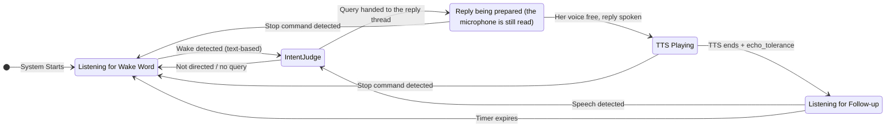

# Listening Flow Specification v2

This document outlines the voice listening architecture. The system uses a **transcript-first** approach where speech is continuously transcribed, and an LLM intent judge extracts queries with full context.

## Architecture Overview

### Capture format and health

The input stream tries mono at the configured sample rate. Unsupported channel
counts or sample rates trigger bounded retries on the same selected input:
mono, stereo and the device's advertised maximum channel count, at the configured
and native rates, without duplicate attempts. Access and device-availability
errors are not retried as format failures. Both the Windows permission probe and
continuous capture use this negotiation and input selection.

The input comes from `voice_device` through `resolve_input_device`
(`jarvis.utils.audio_stream`), the resolver hold-to-dictate also uses: blank,
`default` or `system` is the system default input, a number is the index of an
input-capable device, and any other text is the first input-capable device whose
name contains it, ignoring case, so output-only devices are skipped. A missing
named microphone, or an index that names no input (out of range, or an
output-only device), produces an actionable error rather than silently
selecting another input.
Multichannel samples are averaged to mono before framing and speech detection.

Frames always span the configured 10, 20 or
30 ms at the actual capture rate; unsupported frame durations use 20 ms. Partial
callback blocks are retained until a complete frame is available and discarded
on audio-state resets. WebRTC VAD receives a 16 kHz mono PCM copy, including when
the hardware captures at 44.1 or 48 kHz. Utterances retain native-rate samples
until resampling for Whisper, preserving their duration.

VAD errors emit a single warning and use the configured energy threshold instead
of silently discarding speech. Capture health is checked every five seconds with
a monotonic clock. Missing callbacks, silent samples, callback errors, PortAudio
status flags and dropped queue blocks are reported outside the audio callback.
Warnings are transition-based; dictation pauses suspend health checks. With
`voice_debug`, diagnostics include callback/frame counts, speech-frame counts,
peak level and capture rate, without saving microphone audio. Linux warnings
point users to PipeWire/PulseAudio recording-source routing.

```
┌─────────────────────────────────────────────────────────────────┐
│                         Audio Stream                            │
└───────────────────────────┬─────────────────────────────────────┘
                            │
            ┌───────────────┼───────────────┐
            ▼               ▼               ▼
┌───────────────┐                  ┌───────────────┐
│     VAD       │                  │   TTS Output  │
│ (speech gate) │                  │   Tracking    │
└───────┬───────┘                  └───────────────┘
        │
        ▼
┌───────────────┐
│    Whisper    │
│ (transcribe)  │
└───────┬───────┘
        │
        ▼
┌───────────────────────────────────────┐
│     Rolling Transcript Buffer         │
│     (2 minutes, with timestamps)      │
│                                       │
│  Segments include:                    │
│  - text, start_time, end_time         │
│  - energy level                       │
│  - is_during_tts flag                 │
└───────────────────┬───────────────────┘
                    │
                    ▼ (on wake detection)
┌───────────────────────────────────────┐
│          Intent Judge LLM             │
│        (gemma4 or main)          │
│                                       │
│  Inputs:                              │
│  - Transcript buffer (recent)         │
│  - Wake word timestamp (if any)       │
│  - Last TTS text + finish time        │
│  - Current state                      │
│                                       │
│  Outputs:                             │
│  - directed: bool                     │
│  - query: "extracted clean query"     │
│  - stop: bool                         │
│  - confidence: high/medium/low        │
│  - reasoning: "brief explanation"     │
└───────────────────┬───────────────────┘
                    │
                    ▼
┌───────────────────────────────────────┐
│           Reply Engine                │
└───────────────────────────────────────┘
```

## Key Design Principles

### 0. Serialised PortAudio Lifecycle

All stream lifecycle calls (`InputStream`/`OutputStream` construction,
`start`/`stop`/`close`/`abort`) run under the process-wide
`jarvis.utils.audio_lock.portaudio_lock`, shared with the dictation engine,
TTS, and the thinking tune. PortAudio documents stream open/close as not
thread safe; unserialised calls across threads abort the whole app on
Windows. The run loop uses `_serialised_stream` instead
of the raw `with stream:` context manager. Two deliberate exceptions: the
Windows mic-permission probe opens its stream *without* the lock (that open
can hang indefinitely when Windows blocks mic access, and hanging while
holding the process-wide lock would freeze every audio user), and its
timeout path abandons a blocked stream instead of aborting/closing it from
another thread: the check thread may still be inside `start()`/`stop()`
on it, and a cross-thread close is a native use-after-free.

### 1. Transcript-First

Instead of extracting post-wake-word audio, we:
- Continuously transcribe all speech (VAD-gated)
- Store transcripts with timestamps in a rolling buffer
- Let the intent judge extract the relevant query

**Benefits:**
- Pre-wake-word chatter naturally filtered: "blah blah Jarvis what time is it" → "what time is it"
- Full context available for intent understanding
- Echo detection via multi-layer approach (fuzzy text matching + LLM intent judge)

### 2. Text-Based Wake Detection

Wake word detection operates on the rolling transcript buffer. When Whisper produces text, it is checked for the configured wake word and aliases. This supports arbitrary wake words in any language.

**Names are whole words.** The wake word and each alias are names, found only where they stand as whole words: neither end of the name runs on into a letter, a digit or a combining mark of the word around it, in any alphabet. "Charismatique" does not hold the alias "charis", nor "mañana" the name "ana", whether its "ñ" is written as one character or as an "n" and a combining tilde. Punctuation around a name is no part of a word ("Jarvis, …", "…, Jarvis ?", "«Jarvis»"). The words of a name of several words ("jar is") are found whatever the spacing between them, and not when its last word starts a longer one ("jar isolé"). The exception is text that does not mark where its words end: Chinese characters, kana and Hangul (whose particles join the name before them), and the scripts of South-East Asia (Thai, Lao, Khmer, Myanmar, the Tai scripts). There a name is found among the words around it. A name configured empty is found nowhere.

**Close spellings.** Failing a whole-word match, each token of the text, split on whitespace and stripped of the punctuation at its ends, is compared with every name using difflib's `SequenceMatcher`, and a ratio of at least `wake_fuzzy_ratio` (0.78 by default) counts as the name: "jarvas" for "jarvis". A whole token is weighed against a whole name, so a name inside a much longer word scores low ("charismatique", 0.63 against "charis"), but a word one letter away from a short name passes ("charisme", 0.86 against "charis"), and so do ordinary words close to a short alias ("jours", 0.80 against "joris"; "avis", 0.89 against "javis").

**Taking the name out.** When the wake word is what decides that he is speaking to her, the words where a name stands whole are taken out of what he said, with the spacing around them, and every other word is kept as it was heard: "Jarvis, est-elle charismatique ?" is answered as "est-elle charismatique ?". Commas, full stops, question and exclamation marks, semicolons and colons left at the start of what remains are dropped. A token that matched only as a close spelling stays in.

### 3. Context-Aware Intent Judge

The intent judge receives full context and makes intelligent decisions:
- Knows what TTS said → can identify echo vs real speech
- Sees pre-wake-word context → can understand "...what do YOU think, Jarvis?"
- Extracts clean query → removes filler words, false starts

**Gating:** The judge is called only when there is an engagement signal — (a) a wake word was detected in the current utterance, (b) the utterance falls inside (or pending) a hot window, (c) TTS is currently speaking, or (d) his question is still being collected and nothing else took the utterance, where only its `stop` and `noise` are read (see "Text Whisper Makes Out of Silence"). Pure ambient speech skips the judge entirely. This keeps the synchronous audio loop from blocking up to `intent_judge_timeout_sec` on every background utterance, which would otherwise freeze the UI when Ollama is slow or contended.

**Alias normalisation:** Before the transcript is sent to the judge, every configured wake-word alias in each segment is replaced with the primary assistant name (case-insensitive, word-boundary-aware). Aliases are Whisper mishearings of the wake word (e.g. "Jervis", "Jaivis" for "Jarvis"); without this step the small judge model sees the alias, doesn't know it refers to the assistant, and can decide the user is addressing a different person. Normalisation happens at prompt-build time only — the raw transcript buffer is untouched.

**Wake-word removal in the extracted query:** The wake word is addressed TO the assistant, never part of the query content. The judge prompt explicitly instructs removing every occurrence of the wake word from the extracted `query` — at the start, end, or middle of the sentence, including when it sits next to a named entity (e.g. "movie called Possessor Jarvis" → film is "Possessor", not "Possessor Jarvis"). The only exception is when the user is literally talking *about* the assistant as a subject ("tell me about Jarvis"). This is enforced by prompt rule + example rather than post-hoc string stripping, because the LLM already understands the semantic distinction and can handle cases a regex would mishandle (e.g. proper names that contain the wake word, like "Jarvis Cocker").

**Model residency (`keep_alive`):** Each intent-judge request asks Ollama to keep the model resident after the call. The default duration is 30 minutes, which avoids cold reloads between utterances. When `cfg.low_power_mode` is true, the duration is 1 minute so the model can unload soon after an active exchange. The trade-off is latency: low-power sessions can pay a cold-load cost after idle periods, while default sessions keep the judge model (default `gemma4:e2b`, ~2 GB) in RAM/VRAM during active voice use.

### 4. The Microphone Is Always Read

The capture callback stamps each block with the time it was captured and queues it. The listening loop reads the queue frame by frame, and an utterance's start and end are read from those stamps, so audio the loop reaches late still says when it was spoken: the echo detector, the hot window and the latency journal compare these times with when she spoke, and the silence that ends a question being collected is counted in them.

**Replies run on a thread of their own.** Once a query is collected, the loop hands it over (`_hand_over`) and goes back to listening; the reply thread runs the queries one after the other, each through the reply engine and then out loud. While she prepares an answer and while she says it, what he says is still heard.

- **A question asked while a reply is on its way waits its turn.** It is answered after the one in hand, never alongside it, and only once her voice has stopped: a reply started while the last is still audible would replace the echo detector's record of it, and that one's window would open over the new one. At most `MAX_WAITING_TURNS` (2) wait; past that the oldest is dropped with a console line, so a wake word repeated by a film cannot stack up replies that would run minutes later.
- **A stop silences the reply.** Heard while a reply is being prepared, said or waits to be, a stop says nothing more of the reply in hand (no sentence streamed after it, no tail), drops the questions waiting behind it and a question still being collected, and interrupts the speech engine. Each stop is counted, and a turn handed over before the count moved is never said: one stopped while it waited for the query lock is not run at all. The engine finishes a turn already running on its own, unheard; its tools still run. A stopped turn is no longer a reply on its way, even while the engine finishes it: the thinking tune and THINKING are not kept for it, and when the engine is done with it, what he has started since (a question being collected or handed over) keeps its tune and the published state. Replies other features handed over are kept.
- **What counts as a stop.** While she speaks, any utterance holding a stop command, as before; while a reply is on its way, or one a stop silenced is still being finished by the engine, or his question is still being collected, an utterance of at most `STOP_WORDS_WHILE_THINKING` (3) words (a stop he repeats, "Jarvis, stop !", is still a stop, never a question), because a stop word inside a longer sentence ("Jarvis, how do I stop the timer?") is a question, and waits its turn. A stop the intent judge reads out of a sentence counts the same.
- **Her spoken question is answered by what he says to it.** A spoken question is settled by the next voice turn (`tools/policy.spec.md`), so a turn whose words he said before he finished hearing it is set aside, with a console line, and the question waits for his answer. A question he never heard, its reply having been stopped, is withdrawn as `expiré` before the next turn runs.
- **Speech ignored while a reply is on its way leaves her thinking.** The thinking tune is that reply's: an utterance that is not for her does not stop it, and the published state stays THINKING.
- **The reply thread is the only one that speaks.** Her answers and the replies other features hand over (`enqueue_reply`, "Speaking Something Produced Elsewhere") leave from it, so the echo detector's record of what she last said has one writer.
- **The turn keeps what was true when he asked.** The language he was heard in, his exact words and when he stopped speaking travel with the query: the loop goes on transcribing while the reply is prepared. His exact words are the last utterance collected into it, whole; one left out, such as a phrase Whisper made out of silence, does not answer for him.

**The loop still waits on Whisper and on the intent judge.** The queue holds `AUDIO_BACKLOG_SECONDS` (30 s), with room to spare over the judge's default per-read deadline, so a stall delays his words instead of dropping them. Nothing empties it on a hand-over, an accepted utterance or a stop: what it holds was said after the utterance just handled. A block that finds the queue full is dropped and counted (`⚠️ Audio capture: queue full; N blocks dropped`). The judge may now run while the reply engine works; on one local Ollama the two can wait on each other.

## Startup & Model Warmup

Before the listener announces "Listening!", it pre-loads every model the first engagement will need. All warmup output is grouped under a single `🔥 Warming up models...` header with indented child status lines, e.g.

```
  🔥 Warming up models...
     🎤 Whisper 'small' loaded on cpu
     💬 Chat model 'llama3.1' ready
     🧠 Intent judge 'gemma4:e2b' ready
🎙️  Listening! Try:
      "How's the weather, Jarvis?"          ← when location is known
      "How's the weather in [your city], Jarvis?"  ← when location is disabled or not configured
      "I just ate a Big Mac, Jarvis."
      "What are you thinking, Jarvis?"
      "What do you know about me, Jarvis?"
```

The weather example adapts to location availability: if `location_enabled` is true, a location source is configured (`location_auto_detect` or a manual `location_ip_address`), **and** the GeoLite2 database is present (`is_location_available()` returns true), the plain form is shown; otherwise the `[your city]` placeholder form is shown so the user understands they must substitute a real city name in their query.

On small models, a caveat line is appended above a more involved example to set expectations (`⚠️ Small model in use (…). Assume it can't infer — spell out the steps for anything more involved:`). The Chrome MCP tip continues to appear as its own block when the browser tool is detected.

**What gets warmed:**
- **Whisper**: loading the model; additionally a silent-audio transcribe so the first real utterance doesn't pay the cold-decode cost. Both the MLX and faster-whisper backends do this.
- **Chat model** (`cfg.llm_chat_model`): a minimal Ollama `/api/generate` request with the configured power-mode `keep_alive` so the weights stay resident.
- **Intent judge model** (`cfg.intent_judge_model`): same pattern. If it points at the same Ollama model as the chat model, a single warmup covers both roles (Ollama loads the weights once).
- **Tool router model**: warmed only when `tool_selection_strategy == "llm"` and the resolved router model is distinct from the chat and intent-judge models.

**Low-power mode:** When `cfg.low_power_mode` is true, the listener skips chat, intent-judge, and router warmup threads and prints `🌱 Low power mode: LLM warmup skipped`. Whisper still warms because speech recognition needs to be ready before the listener can accept input. The first LLM-backed engagement after startup or idle loads models on demand.

**Concurrency:** LLM warmups run in daemon threads started before Whisper loads, so they overlap with Whisper initialisation. After Whisper finishes, the listener joins the warmup threads with a **single 60 s budget** shared across them all. If the budget is exhausted, the listener continues (with a `⏳ Some models still warming — continuing anyway` notice) and the first engagement pays the cold-load cost on demand.

**Best-effort semantics:** Every warmup path swallows its own errors and returns a bool. A failed warmup prints `⚠️ … warmup failed — will load on first use` but never blocks or crashes the listener — voice input is prioritised over startup latency.

## The Three Listening Modes

### 1. Wake Word Mode (Default)

System is waiting for wake word activation.

**Triggers:**
- Text-based detection finds the wake word or an alias in the transcript, as whole words or as a close spelling (see "Text-Based Wake Detection")

**On trigger:**
1. Start thinking beep immediately and publish the state LISTENING
2. Wait for utterance to complete (user finishes speaking)
3. Send transcript buffer + wake timestamp to intent judge
4. If `directed=true` and `query` exists, collect it, and hand it to the reply thread once he has stopped for `voice_collect_seconds`; a verdict that finds nothing but her name leaves the decision to the wake-word check (below)
5. If rejected, stop the beep and publish IDLE

**Her name with nothing after it opens a question with nothing in it yet.** When the wake-word check finds nothing after the wake word, she waits for his question as for any other. Nothing means no letter or digit in any script once the wake word and its aliases are taken out: "Jarvis ?", "¿Jarvis?", "Jarvis…" and "Jarvis ! Jarvis !" are her name alone. The console says `👂 Waiting for your question...` rather than announcing a query, shown at once even through a pipe; the thinking tune plays, never over her voice; LISTENING is published; and what he says before his silence has lasted `voice_collect_seconds` is his question. When the silence runs out with nothing collected (no letter or digit: punctuation Whisper makes out of the quiet is nothing either), nothing is handed over and the wait ends where he can see it: `💤 Nothing after the wake word, returning to wake word mode` is printed, and the published state goes back to what she is doing. While she speaks she is SPEAKING; while a reply of hers is on its way she is THINKING, and the tune, which is that reply's, plays on; otherwise the tune stops and she is IDLE. A reply stopped since it was handed over is not on its way (see "The Microphone Is Always Read"). While he dictates, nothing is published: the dictation's state stands. The hot window comes to the same wait when a wake word that can only be his leaves the decision to the wake-word check (see "Hot Window Mode").

**The intent judge does not answer her name as a question.** Outside the hot window, a directed verdict that finds nothing but her name, in what he said and in the `query` it reads, decides nothing, whatever its confidence: the wake-word check does, and she waits for his question as above. A query that holds more than her name is a question the judge read in his earlier words, and it is answered.

**A sentence heard while a question is still being collected completes it**, in this mode and in the hot window. Every path that accepts an utterance adds it to the question being collected, never puts it in its place, and she answers both: "Salut Yuba, comment tu vas ?" then "Tu m'entends Yuba ?" is one question. A collection that keeps being completed still ends after `voice_max_collect_seconds`. The silence that ends it is counted from the end of the last utterance collected, in the time its audio was captured: neither Whisper nor the judge adds to the wait, and audio the loop reads late, after a stall, is measured in its own time, so his next words still complete the question. Whatever joins it is marked processed, like every accepted segment, so the judge never sees it again as context it could restate. A stop heard while it is collected cancels it instead (see "The Microphone Is Always Read"). What he adds needs no wake word, so Whisper's inventions reach the question too: one the judge calls noise is left out (see "Text Whisper Makes Out of Silence").

### 2. Hot Window Mode

After TTS finishes, allow wake-word-free follow-up.

**Activation:** `echo_tolerance` seconds after TTS ends (allows echo to settle)

**Duration:** Configurable (default: 3 seconds)

**Behaviour:** Speech first passes through an early fuzzy echo check (rapidfuzz `partial_ratio`, threshold 70, with word-count guard to avoid catching mixed echo+speech). Pure echo is rejected with `🔇 Heard (echo)` **without calling the intent judge** — this keeps echo rejection instant and prevents it from blocking the audio loop. The early check stands aside while she speaks (see "During TTS") and while the thinking tune plays; with the tune playing, pure echo heard in the hot window reaches the judge, and the checks after its verdict set it aside with the same line. The hot window timer is **not** reset on echo rejection. Non-echo speech is sent to the intent judge, and if the judge rejects it, the rejection is overridden: non-echo speech in the hot window is accepted as a follow-up query. An echo verdict is overridden only on positive evidence (see "Overriding an echo verdict takes positive evidence"). Words that could be her own voice coming back, the ones the judge is shown "(during TTS)" (see "During TTS"), are taken by no override: whatever words the judge finds for leaving them out, a rejection that does not say echo or a directed verdict with no query, they are set aside as an echo verdict that stands sets them, with `🔇 Heard (echo)`. The listener decides it on the text as it stands once an echo prefix is stripped. In the hot window the judge's confidence changes none of this: a verdict it is unsure of goes through the same overrides as one it is sure of, a directed verdict with no query takes what he said whatever its confidence, and every path a verdict takes there ends in a console line that says what became of the utterance, a stop aside: that one she obeys out loud. The judge's confidence is "low" whenever its answer leaves it out. The wake word is his call in the hot window as outside it, where it can only be his: an utterance carrying such a wake word that the verdict extracts no query from, her reply coming back whole aside, goes to the wake-word check, which answers what was heard with the wake word taken out, so a quiet answer of his that could be hers is still answered when he names her. A wake word can only be his when the wake-word check finds it in the utterance, finds none in her reply, and still finds it once the words of her reply are taken out. Her reply can name her, or say a word the check takes for her name ("avis" for "Jarvis"; with the default aliases, common words such as "jours" or "chairs" too), and coming back that word can take any spelling Whisper gives her name, so after such a reply no wake word heard can be told from hers, his quiet answer naming her included: it is set aside with the other words that could be hers. Whisper can also bend a word of hers into one ("servi" heard "servis", close to the alias "jervis"): that word is still hers as long as it stays as close to hers as the word test of "Overriding an echo verdict takes positive evidence" asks, and so is his wake word when it comes that close to a word of hers ("jarvis" to the "avis" of her "d'avis"). Two of her words merged into one ("Dave is" heard "Davis") or a sound spelled another way ("à vie" heard "avis") go beyond that test and pass for his. With no verdict (a timeout, or the judge's back-off after a connection error) the hot window tells his words from hers as it does behind a verdict: her reply coming back whole is set aside with `🔇 Heard (echo)`, and so are words that could be hers, unless they carry a wake word that can only be his, which leaves the decision to the wake-word check; anything else is his and is answered as he said it, a wake word in it included. Outside the hot window, a verdict below high confidence leaves the decision to the wake-word check. Speech, not text: a segment the judge calls noise is not speech, and nothing overrides that verdict (see "Text Whisper Makes Out of Silence").

**Mixed echo+speech handling:** When Whisper merges TTS echo and user speech into one chunk (e.g. mic picks up TTS then user speaks), the word-count guard detects the extra content and lets it through to the intent judge. The judge extracts the user's actual query from the mixed transcript. Post-judge echo checks also use the word-count guard and verify the judge's extracted query isn't itself echo before rejecting.

**Early salvage for echo-prefixed follow-ups:** Before the early fuzzy check rejects a chunk as pure echo, the listener calls `cleanup_leading_echo` to strip any TTS-tail prefix. If exact-word cleanup fails (for example because Whisper mis-transcribed the first echo word — *"explores"* → *"laws"* — breaking the word-level comparison), the listener falls back to `salvage_after_echo_tail`, which scans heard-text word boundaries right-to-left looking for the rightmost 5-word window that fuzzy-matches the TTS tail (`partial_ratio >= 85`) and keeps everything after it. This preserves short follow-ups (*"Who made it?"*) that the existing fuzzy-prefix salvage would otherwise truncate by one word because it prefers the shortest suffix. If the surviving remainder has at least `EchoDetector.min_salvage_words` words (default 3) and carries words she did not say in a voice (the two proofs of "Overriding an echo verdict takes positive evidence"), it replaces the transcript segment text and is treated as the user's follow-up. The same minimum-word threshold is shared by the during-TTS and post-TTS merged-chunk salvage paths, which keep a remainder on that count alone; in the hot window the overrides still set it aside when it could be hers.

**Timestamp-based detection:** `was_speech_during_hot_window(utterance_start_time, utterance_end_time)` compares the utterance's time range against the hot window's time span (from schedule to expiry). This eliminates race conditions between slow Whisper transcription and the expiry timer — if the user started speaking during the window, it counts as hot window input regardless of when the transcript arrives. Also handles **overlapping utterances** where VAD triggered during TTS (mic picking up echo) but the utterance extended into the hot window period.

**`could_be_hot_window` (intent judge context):** Derived from timestamp comparison — returns True if the hot window is active, activation is pending, the utterance started within the window span even after expiry, or the utterance overlaps with the span (started before, ended during).

**Expiry:** Timer-based, guaranteed to fire even if no audio. The `hot_window_seconds` clock starts the instant the window opens, before the state is published and the console is told, so the window is the same length however slow that announcement is (a state file on a busy disk, a console that blocks). An announcement the clock has already outrun is skipped.

### 3. During TTS

While TTS is playing, echo rejection and stop commands are handled with fast text-based checks (no LLM). This prevents self-loops where the mic picks up TTS output. After TTS finishes, the intent judge takes over.

**Stop detection:**
- Text-based: Check for "stop", "quiet", "shut up", etc., while she speaks and while a reply is on its way (prepared, or waiting its turn); while she only thinks, in an utterance of at most three words
- Intent judge can also detect stop commands, with the same effect
- However a stop is heard, the listener interrupts the engine, which drops the rest of the reply, and publishes IDLE: the interrupted reply is unheard, so its completion callback never fires and nothing else would take the published state out of SPEAKING (`state.spec.md`, `tts.spec.md` "Interrupting"). No hot window opens. Nothing more of the reply being prepared is said, and the questions waiting their turn are dropped (see "The Microphone Is Always Read").

**Echo handling:**
- The detector times her words from when the listener handed her the reply,
  plus the speech engine's `voice_delay()`: a talking face holds her voice
  back by its delay (`output/tts.spec.md`, "Kyutai").
- A transcript that could be her own voice coming back is flagged
  `is_during_tts=true`, shown to the judge as "(during TTS)", and the judge
  is told never to extract a query from it. A verdict that extracts one
  anyway is answered, as any directed verdict with a query is (see "Hot
  Window Mode"). Timing says when it could be hers: heard
  while she speaks, or started (the voice detector's pre-roll included)
  before her last word plus `echo_tolerance`.
- Timing does not decide alone. His answer to a question she ends her reply
  on often starts within that tolerance, so an utterance that carries words
  she did not say, loud enough to have been spoken (the two proofs of
  "Overriding an echo verdict takes positive evidence"), is never flagged,
  whatever its timing. Her own words coming back keep the flag, as long as
  Whisper bends no more of them than that test allows (40% of the words
  heard without a close match in her reply), and so does a phrase Whisper
  makes of the quiet right after her: the first carries no words she did
  not say, the second no voice. While she speaks, and over the echo of
  her last words as she stops, her own voice clears the energy bar, so
  there the flag rests on the words alone.
- Intent judge uses this context to identify echo

## Rolling Transcript Buffer

### Design

```python
@dataclass
class TranscriptSegment:
    text: str              # Transcribed text
    start_time: float      # Unix timestamp when speech started
    end_time: float        # Unix timestamp when speech ended
    energy: float          # Audio energy level
    is_during_tts: bool    # Could be her own voice coming back (see "Echo handling")

class TranscriptBuffer:
    max_duration_sec: float = 120.0  # Ambient speech context for intent judging
```

### Memory Alignment

- **Transcript buffer** (`transcript_buffer_duration_sec`): Rolling raw ambient speech. Separate and potentially longer — in group conversations, 2+ minutes of context lets the intent judge synthesise a complete query with relevant information when someone decides to involve Jarvis later in the conversation.
- **Short-term memory** (`dialogue_memory_timeout`): Processed Jarvis interactions (user queries + assistant responses) of the current conversation, which a pause of `dialogue_memory_timeout` ends. Its latest part reaches the model word for word, within `dialogue_context_max_chars`, and its earlier part as the diary's summary (`reply.spec.md`, Recent Dialogue Context). The same duration drives the forced diary update interval.
- **Long-term memory (diary):** Forced update when unsaved messages reach `dialogue_memory_timeout` age, so a long conversation is summarised as it goes. Enrichment retrieves any relevant context from other conversations.

### Methods

- `add(text, start_time, end_time, energy, is_during_tts)`: Add segment
- `get_since(timestamp)`: Get all segments since a timestamp
- `get_around(timestamp, before_sec, after_sec)`: Get segments in time window
- `format_for_llm(segments)`: Format for intent judge input
- `prune()`: Remove segments older than max_duration

## Intent Judge

### Context Duration & Query Synthesis

The intent judge receives the full transcript buffer (default: 120 seconds / 2 minutes) and **synthesizes a complete query** using conversation context.

This enables Jarvis to **chime into ongoing conversations** between people. When someone asks "Jarvis, what do you think?", the judge uses context to understand what they were discussing and creates a complete, actionable query. Vague references like "that", "it", "this", "they" in the current segment are resolved using previous segments in the buffer (e.g. "I think dinosaurs are cool" + "What do you think about that Jarvis?" → "what do you think about dinosaurs being cool").

**Multi-topic disambiguation.** Real buffers often contain interleaved threads from ambient chatter — e.g. a sports conversation running alongside a purchase discussion. When the wake-word segment uses a vague reference or a topic-less question ("what's the price", "how much does it cost"), the judge must pick the thread whose subject fits the question's grammar (a purchasable thing for "price", a release for "when did it come out") and ignore unrelated threads. When resolving to a sub-item ("pro model", "the red one"), the query must include the parent noun/brand so it remains answerable without the transcript. The grammar-matching behaviour lives entirely in the judge's system prompt (no runtime code branch) and is exercised by the `buried_target_*` eval cases in `evals/test_intent_judge.py` — if the small model regresses on this behaviour, those evals catch it.

**Hot-window override.** In hot-window mode the user is always treated as directed; the topic-less / vague-reference heuristics above are subordinate. Short follow-ups like "tell me more", "and?", or "what else" stay directed rather than being rejected as undirected chatter, because the hot window only opens after a completed Jarvis exchange. The rule is about the user, so it does not cover a segment that is not speech at all.

**Declarative statements addressed to the wake word.** Segments where the user shares information, feelings, or an action with the assistant — e.g. "Jarvis, I just ate a burger from McDonald's", "I'm feeling a bit tired today, Jarvis", "my flight got cancelled, Jarvis" — are directed and must be extracted verbatim (wake word removed) as the query. The wake word can appear at the start, middle, or end of the segment; position does not affect directedness. The judge must not reject these as "not a command or question": any segment where the wake word is used to address the assistant (as opposed to a narrative mention like "I told my friend about Jarvis") is directed, regardless of sentence mood.

**Imperative resolution.** The same mechanism covers imperatives that refer to a prior unanswered question. If a prior segment contains a question and the wake-word segment is an instruction like "answer that", "respond to that", "reply to that", "address that", "answer my question", or "go ahead and answer", the query is the prior question itself — not the literal imperative. Whisper tense variants of these imperatives ("answered that", "answers that", "answering that") are treated the same. If the current segment contains both an imperative and a new explicit question, the new question takes priority.

**Multi-person conversation example:**
```
[12:28:30] Person A: "I wonder what the weather will be like tomorrow"
[12:28:45] Person B: "Yeah, we should check before planning the picnic"
[12:29:00] Person A: "Jarvis, what do you think?"
```

The intent judge synthesizes: `"what do you think about the weather tomorrow for the picnic"`

### Text Whisper Makes Out of Silence

Whisper turns silence, breath and room noise into text: mostly the closing lines of videos and subtitle credits ("Thank you.", "ご視聴ありがとうございました", "Продолжение следует...", "Sous-titres réalisés par la communauté d'Amara.org"), often in a language nobody in the room speaks. The confidence filters below catch some of it, not all, and naming the one language he speaks (`whisper_language`) stops the ones in other languages at the source.

The judge's verdict carries `noise`: true when the current segment is such an invention rather than words someone said, and then it is not directed. Words a person said are never noise, however short, thankful, odd or misheard; in doubt the judge says false, and a model that leaves the field out has said false.

- **In the hot window nothing overrides it.** A not-directed verdict with `noise` on an utterance that could be a hot-window follow-up is final: the listener marks the segment processed, so the judge never sees it again as context, prints `🔇 Heard (not speech)`, stops the thinking beep and returns. No hot-window override runs (non-echo speech, an echo verdict with words she did not say and a voice, the grace after the window), because they exist to keep his words, and a hallucination produces words nobody said that the energy test can still take for a voice while she is speaking.
- **While his question is collected it does not join it.** An utterance heard then that no other path took (no wake word, no hot window) would complete his question with no wake word, as a follow-up would, so it is judged as one, in hot-window mode. A verdict already given on it in hot-window mode is used as it is; one given in wake-word mode, while she speaks, read it without the question and without a follow-up's rules, so the judge is asked again. The question collected so far is put back in the transcript, just before the utterance judged: its segments are processed, and an addition read without it, misheard ("et pour à près de main aussi"), looks like something Whisper invented. Only `stop` and `noise` are read, never a query, so the question shown cannot be restated into one.
  - A stop cancels the question, as a stop word does.
  - Not directed and `noise`, the segment is marked processed, `🔇 Heard (not speech)` is printed and it is left out. The thinking tune of his question plays on, and the collection's silence is still counted from the end of his last words, so a phantom never holds his question back.
  - Any other verdict, or none, completes the question. With none, the judge's unavailability is printed.
  - Utterances of three words or fewer are judged here even while she speaks, though the judge skips them in her speech otherwise: Whisper's inventions are that short.
  - It costs a judge call for each utterance that gets this far while a question is collected, and a second one when the first was given in wake-word mode.
- **Elsewhere the verdict changes nothing.** The judge only runs there on a wake word or while she speaks, and Whisper does not invent her name, so a doubtful verdict still falls through to the text wake-word check as any other.
- **His side wins a contradiction.** A verdict that says both `noise` and directed is treated as directed.
- **The window stays open.** Like an echo, a noise verdict does not touch the hot window, so his real follow-up after it is still a follow-up.
- **Fails open.** With no verdict (judge unavailable) or a model that never sets `noise`, nothing is left out as noise: the hot window and the question being collected behave as without this rule. In the hot window, words that could be hers are still set aside (see "Hot Window Mode").

How well it works is the judge model's: a small local model can miss what a larger one catches, and a miss is answered as before. `evals/test_intent_judge.py` holds the inventions and the real follow-ups it is measured on (`TestIntentJudgeKnowsSilenceFromSpeech` on the suite's small model, `EVAL_INTENT_JUDGE_ARMS` on any), and `docs/llm_contexts.md` the measurement.

### Input Format

```
Transcript (last 120 seconds):
[12:28:30] "I wonder what the weather will be like tomorrow"
[12:28:45] "Yeah, we should check before planning the picnic"
[12:29:00] "Jarvis what do you think"

Wake word detected at: 12:29:00.8 (text-based)
Last TTS: "The weather is sunny and 72 degrees"
TTS finished at: 12:28:02
Current state: wake_word_mode
```

### Output Format

```json
{
  "directed": true,
  "query": "what do you think about the weather tomorrow for the picnic",
  "stop": false,
  "noise": false,
  "confidence": "high",
  "reasoning": "synthesized context from conversation about weather and picnic"
}
```

### Multi-Layer Echo Detection

Echo detection uses a layered approach for reliability:

1. **Fuzzy text matching (safety net):** `rapidfuzz.fuzz.partial_ratio` compares transcript against last TTS text. Score ≥ 70 = echo. This runs before the intent judge and catches obvious echoes quickly, including in the hot window directed path.
2. **Intent judge (contextual):** Receives `last_tts_text` and timing context. Can identify echo even when fuzzy matching misses subtle cases, and can extract real user speech from mixed echo+speech chunks.

The fuzzy check acts as a fast, reliable safety net. The intent judge provides deeper understanding but may be unreliable with smaller models (e.g. gemma4).

3. **Overriding an echo verdict takes positive evidence.** When the judge says an utterance is her own echo, that verdict stands unless the utterance carries words she did not say: the share of heard words with no close match in her reply must exceed 40%. Her reply is the one the judge was shown: a reply that starts while the judge is thinking does not change what its verdict is weighed against. The override exists for barge-in, and barge-in is what that measures.

   Absence of a fuzzy match is not evidence of speech. `partial_ratio` looks for a contiguous window, so an echo Whisper decimated — words dropped from the middle, others corrupted — stops matching and used to read as new content, which had her run a full turn on her own voice. Per word nothing separates the two: `même` against `semaine` scores what a genuinely new word scores. Over the whole utterance it separates cleanly, and stably — measured on real transcripts, the two echoes sat at 0% and 18% and barge-in at 62% and 100%, unchanged whether the per-word bar is 70, 80 or 90.

   **And it takes a voice.** Text alone cannot separate a hallucination
   from a barge-in: Whisper turned background noise into "Thank you."
   over her French reply, the words-she-did-not-say test answered yes
   because there were, and she replied to it. A hallucination produces
   words *nobody* said, so that premise fails on it.

   What separates them is that one of them moved air. Overriding an echo
   verdict therefore needs both: words she did not say, and an utterance
   whose energy rises above the ambient floor recorded when she started
   speaking, by the same `energy_spike_threshold` the detector already
   applies to this question in the post-TTS cooldown. Either test alone
   was fooled — text by a hallucination, energy by a door slamming.

   The floor is read once per reply, when her first sentence is queued:
   the mean level of the last 50 frames the listening loop has read (a
   second at the default 20 ms frame, and older than that while the loop
   is busy with Whisper or the judge). It holds for the whole reply. A
   reply spoken as it is written (`output/streaming.spec.md`) can queue a
   later sentence while the microphone hears her say an earlier one,
   whenever she is heard before the reply is written in full; a floor read
   then would be her own voice, and his soft answer right after her last
   word would fall under the bar it sets. Whatever the microphone heard in
   that second is in the floor, and raises the bar with it: the thinking
   tune, which plays until her reply is handed over, and, for a reply from
   elsewhere said the moment another ends (see "Speaking Something
   Produced Elsewhere"), the end of the one before.

   Both together are still fooled by a hallucination while she speaks, and
   over the echo of her last words as she stops, since her own voice
   clears the energy bar. That one the judge names: a verdict that calls
   the utterance noise is never overridden (see "Text Whisper Makes Out of
   Silence").

   Fails open: with no TTS text to compare against, everything is the user's.
   The energy half fails open twice over — no baseline, or an energy of
   zero, which is the listener's "not measured" value rather than a claim
   of silence.

   The same two proofs decide which transcripts are flagged as possibly hers
   (`is_during_tts`, see "During TTS"), so the judge is not told in the first
   place that words with both are her echo, and no hot-window override takes
   words without them that were heard in her time, whether the judge gave a
   verdict or none. A wake word among those words is weighed with them,
   unless it can only be his (see "Hot Window Mode"): a verdict that
   extracts nothing from an utterance carrying such a wake word is not
   weighed here at all, wherever in the hot window it was heard, and the
   wake-word check decides.

Example:
```
TTS: "The weather is sunny and 72 degrees"
TTS finished: 12:30:14

Transcript:
[12:30:15] "The weather is sunny and 72 degrees" ← Echo (fuzzy score 100, rejected)
[12:30:18] "Ni hao" ← Real speech (fuzzy score < 70, sent to judge)

Judge output: {"directed": true, "query": "Ni hao", "reasoning": "New speech directed at assistant"}
```

## Early Feedback (Beep & Published State)

To minimise perceived latency, audio and visual feedback starts **immediately after Whisper transcription**, before the intent judge runs. The visual half is the assistant's shared state (`src/jarvis/state.py`, see `state.spec.md`), which whatever shows the assistant to the user reads:

- **Wake word mode:** If the transcribed text carries the wake word, as "Text-Based Wake Detection" finds it, start the thinking beep and publish LISTENING.
- **Hot window:** If voice started during an active (or pending) hot window, start the thinking beep and publish LISTENING.
- **No trigger:** If neither condition is met, no feedback is given.

If the intent judge later rejects the query (and no hot window override applies), the beep is stopped and the state reverts to IDLE, unless a reply of hers is on its way: the tune is then that reply's, and it plays on. Her name followed by nothing ends as "Wake Word Mode" describes. This brief false-positive beep is acceptable — users prefer immediate acknowledgement over delayed but perfect accuracy.

**LISTENING is not published early during TTS** — the beep is suppressed while TTS is playing to avoid self-triggering.

## Timing Marks (Latency Journal)

The listener feeds the latency journal (`src/jarvis/latency.py`, see `latency.spec.md`). It binds the journal to its database and the user's settings when it is built; notes every non-empty transcript with the moment the user stopped speaking (the close of the utterance less the trailing silence the voice detector waited through); times the intent judge call and records what kind of answer it gave; opens the turn when it dispatches the query, hands the journal's stage callback to the reply engine, freezes the turn when the engine returns, and writes it once the reply has been queued for speech. The marks hold durations and enumerations, never text, and cannot change what the listener does: none raises, and with the journal off each costs a lock and a clock read.

## Configuration

```json
{
  "transcript_buffer_duration_sec": 120,

  "intent_judge_model": "gemma4:e2b",
  "intent_judge_timeout_sec": 15.0,

  "hot_window_seconds": 3.0,
  "echo_tolerance": 0.3
}
```

| Setting | Default | Description |
|---------|---------|-------------|
| `transcript_buffer_duration_sec` | 120 | Duration (seconds) for rolling ambient speech transcript. Provides conversation context so the intent judge can synthesise a complete query when someone involves Jarvis. Separate from dialogue memory. |
| `whisper_language` | `""` | Code of the one language Whisper transcribes in, for the listener and dictation alike, from `WHISPER_LANGUAGES` (Whisper's own list; "fr-FR" reads as "fr"). Empty (or `auto`): it detects the language of each utterance, which a multilingual user needs and which lets it invent phrases out of silence in any language and spell a short word in another script ("Стоп."). Named, it transcribes only that language, and that is the language reported for each utterance. A code Whisper does not know, or a language other than English with an English-only (`.en`) model, is announced once and read as empty: passed on, it would fail every transcription or report the wrong language. |
| `voice_collect_seconds` | 4.5 | Silence after which the question being collected is handed to the reply thread, counted from the end of the last utterance collected, in the time its audio was captured. |
| `voice_max_collect_seconds` | 180.0 | Longest a question is collected, however often it is completed. |
| `whisper_min_confidence` | 0.3 | Minimum `avg_logprob`-derived confidence score for a transcribed segment. Segments below this are discarded before the intent judge sees them. |
| `whisper_no_speech_threshold` | 0.5 | Hard cutoff on Whisper's `no_speech_prob` field. Any segment at or above this value is discarded **regardless of `avg_logprob`** — Whisper can be confident about a hallucinated phrase even when no real speech is present (e.g. the "MBC 뉴스" hallucination on background noise). This filter runs before the `avg_logprob` check so it catches high-confidence hallucinations that would otherwise survive. Applies to both the faster-whisper and MLX backends. |

**Repetition guard.** Past the confidence filters, a transcript is
discarded when it loops: one word over half the tokens, the same word
three times running, a short character pattern repeating, or **a phrase
of two to ten words repeated three times back to back**. The last is not
covered by the others — measured on "There we go." thirteen times over
air-conditioning hum, no single word reaches a third of the tokens and
none ever falls twice in a row, because the other two sit between each
repetition.

Three repeats, never two: people say things twice ("oui oui, vas-y"), and
a guard that ate an emphatic repeat would cost real sentences. Each
hallucination that survives costs an intent-judge call on the cloud model
to be told it is not directed.

Note: the intent judge has no enable flag. A connection error puts it in a 30-second back-off during which `judge()` returns without calling the backend; the listener still takes its no-verdict path, so in the hot window his follow-up is kept, words that could be hers are set aside with `🔇 Heard (echo)` (see "Hot Window Mode"), and the unavailability is printed to standard output. Outside a hot window, text-based wake detection answers as usual. A request that outlives `intent_judge_timeout_sec` gives no verdict either, without the back-off, so the next engagement asks the judge again. The audio loop waits at most that long for a server that goes quiet; as with every request timeout here it is the HTTP client's connection and per-read wait, not a wall-clock cap on the whole exchange.

## State Transitions



## Audio Pipeline

```
Microphone Audio
    ↓
Sounddevice Callback → _audio_q
    ↓
Main Loop: Get Frames → VAD Check
    ↓
Speech Detected → Accumulate Frames
    ↓
Silence Timeout → Whisper Transcription
    ↓
Add to Transcript Buffer (with timestamps; flagged "(during TTS)" when it could be her echo)
    ↓
Wake Detection Check:
    └→ Text contains wake word? → Start thinking beep + publish LISTENING
    ↓
If wake detected OR in hot window:
    → Fuzzy echo check, unless she speaks or the thinking tune plays (partial_ratio ≥ 70 = echo → 🔇 Heard (echo), hot window timer untouched)
    → Send buffer + context to Intent Judge
    ↓
If no verdict, in hot window:
    → Her reply coming back whole: 🔇 Heard (echo)
    → Words that could be hers: 🔇 Heard (echo), unless they carry a wake word that can only be his: wake-word check, as below
    → Otherwise: collect what he said as a query
If judge rejects and says noise, in hot window:
    → Not speech: mark processed, ignore, hot window untouched
If judge.directed, outside the hot window, and neither what was heard nor its query holds more than her name:
    → Wake-word check: her name alone, she waits for his question
If judge.directed and judge.query:
    → Verify wake word present (wake word mode) or non-echo (hot window)
    → Collect it (added to a question being collected), then hand it to the reply thread (it waits its turn)
If no query extracted, in hot window, and a wake word that can only be his (found in the utterance, none in her reply, still found once her words are taken out; not her reply coming back whole):
    → Wake-word check: collect what was heard, the wake word taken out
If judge.directed without a query, or rejects, in hot window, at any confidence:
    → Words that could be hers (heard in her time, without words she did not say in a voice): 🔇 Heard (echo)
    → Otherwise, not pure echo: collect what he said as a query
    → An echo verdict: only on words she did not say, in a voice; otherwise 🔇 Heard (echo)
If nothing above took it and a question is being collected:
    → Judge it as a follow-up, his question before it (unless already judged as one)
    → Stop: cancel the question
    → Noise, not directed: mark processed, leave it out, silence clock untouched
    → Otherwise: mark processed, add it to the question
When his silence has lasted voice_collect_seconds:
    → A letter or digit collected: hand it to the reply thread
    → Nothing collected (her name alone, punctuation at most): 💤 Nothing after the wake word, nothing handed over;
      published state back to SPEAKING, THINKING (the reply's tune plays on) or IDLE (tune stopped);
      while he dictates, the dictation's state stands
```

## Keeping a Copy of an Utterance

Off unless `JARVIS_SAVE_AUDIO=<directory>` is set in the environment.
There is no config key, no default and no UI toggle: a microphone writing
his voice to disk is the most sensitive thing here, and the only switch
that cannot be left on by a past session is one that dies with the shell.
When it is live the listener says so at startup, naming the directory.

Each utterance is written as 16 kHz mono WAV with a JSON sidecar holding
Whisper's hypothesis, the model, the input device, the duration and the
RMS. `reference` and `keywords` are left empty for him to fill in:
deriving a reference from the hypothesis would score the recogniser
against itself.

Utterances that transcribed to nothing are kept. Silence and noise are
where an autoregressive decoder and a transducer part company, so a
corpus of successes only would measure the easy half.

The capture sits before the empty-transcript return and never raises:
the listener's loop reads the audio queue on a deadline, and a capture
that threw would cost the sentence it was meant to record.

`scripts/asr_bench.py` scores such a corpus across recognisers, reporting
word and character error rates alongside recall on the declared keywords.

## Speaking Something Produced Elsewhere

Some replies are not answers to an utterance: a tool approved by a click
on a card runs on its own worker, and the sentence describing what
happened has to be said out loud.

That worker never speaks. It calls `enqueue_reply(text)`, and the
listener's reply thread says it, through the same `_speak_reply` path it
uses for her own replies. Two speakers would both write the echo
detector's record of what was last said, and the next transcript would
then be compared against the wrong sentence — which is how a user's
answer gets deleted as an echo.

**The reply thread drains it on every pass**, between queries and
whether or not anyone speaks, so a narration never waits on the
microphone. A query being answered keeps it waiting until that reply has
been handed to the speech engine. A stop leaves it queued: it is owed by
another feature, and a reminder is a promise.

**The language is the one last heard.** A reply from elsewhere has no
utterance behind it, so it is spoken with the language the user was last
heard in, and the engine's configured `response_language` outranks that
(`tts.spec.md`, "Which language wins"). A reply of her own carries the
language heard for it, fixed when the query is handed to the reply
thread and shared by every sentence of it.

**One reply per pass, and none while she is already speaking.** The echo
detector holds the record of one reply at a time: the text she is
saying, when she began, its exact duration, and the floor of the voice
proof (see "And it takes a voice"). Starting a second reply while the
first is still audible would replace that record with the second's, and
the rest of the first would be compared against the wrong sentence.
Completion callbacks are not the constraint, since they travel with
their own queue item (`tts.spec.md`, "The queue"). Anything still queued
waits for the reply thread's next pass, a few milliseconds away when no
query is running.

## Fallback Behaviour

When components are unavailable, the system degrades gracefully:

| Component | Unavailable Behaviour |
|-----------|---------------------|
| Intent Judge | Simple text-based wake word + query extraction; in the hot window his words are still kept and words that could be hers set aside |
| 16 kHz sample rate | Stream at device native rate, resample to 16 kHz for Whisper |
| Transcript Buffer | Process each utterance independently |
| `large-v3-turbo` on faster-whisper older than 1.1.0 | Load `large-v3` instead and say so (`⚠️ large-v3-turbo is not supported…`). MLX always runs it |

Whether the installed faster-whisper runs `large-v3-turbo` is `is_faster_whisper_turbo_supported()` in `jarvis/listening/whisper_turbo.py`, the one check the listener and the setup wizard share. It reads the version from the package's installed metadata (`importlib.metadata.version("faster-whisper")`) and never imports the package, so the wizard can ask on its UI thread without loading ctranslate2. A missing install or an unreadable version reads as unsupported. The distribution name stays a literal in that call: PyInstaller's analysis ships the metadata of the names it sees passed to `version()`, which is how the frozen build can answer at all.

## Download Recovery

Whisper model loading handles transient download failures automatically:

### Visible Progress and Resume

Before `WhisperModel` (faster-whisper) or the first MLX `transcribe` call runs, the listener pre-downloads the model's HuggingFace snapshot with `download_snapshot_with_progress` (`jarvis/utils/hf_download.py`). faster-whisper silences huggingface_hub's progress bars and the daemon never has a TTY, so without this a multi-GB first-run download printed nothing. The helper watches the repo's `blobs` cache directory and prints a throttled `⬇️ Downloading … X/Y MB · rate` line (or `X MB so far` when the total size cannot be learned), plus a "still downloading" line if the transfer stalls. A warm cache prints nothing. Pre-download failures never block loading: `WhisperModel`'s own offline/cache paths take over. Resume on interruption is huggingface_hub's `.incomplete` + HTTP `Range` mechanism, so a killed download continues where it stopped. On Windows, a WinError 1314 (symlink privilege not held) escaping huggingface_hub's support probe at the pointer-creation step is caught and retried once with plain file copies, so the completed download is not thrown away.

### Corrupted Cache Recovery

If the HuggingFace model cache is corrupted (e.g. from an interrupted download), the system detects the CTranslate2 "unable to open file" error, deletes the parent `models--` cache directory, and retries the download once. If the retry also fails, a message guides the user to manually delete the cache.

### Rate Limit Retry (HTTP 429)

When HuggingFace returns HTTP 429 (Too Many Requests), both faster-whisper and MLX Whisper backends retry up to 4 times with exponential backoff (2s, 4s, 8s, 16s). Progress messages inform the user of each retry attempt. If all retries are exhausted, the user is advised to wait and restart.

## Future: Acoustic Echo Cancellation

Currently, echo is handled at the transcript level via fuzzy text matching and the intent judge. True acoustic echo cancellation (AEC) would:
- Require the audio output signal (reference)
- Process in real-time with adaptive filtering
- Add 10-50ms latency

**Current recommendation:** The transcript-level echo detection (fuzzy matching + intent judge) is sufficient and simpler. Consider AEC only if transcript-level detection proves inadequate in practice.

## The word that wakes her

`whisper_min_confidence` (0.3) is computed from `avg_logprob`, and that
is a poor judge of a proper noun the model has never seen — which is
exactly why "Yuba" comes back as "Youba", "Nuba", "Juba". The segment
carrying the wake word scores low, is dropped, and the sentence that
follows arrives with no wake word in it and is ignored. She then looks
broken, which is the one failure a wake word cannot afford.

A segment about to be dropped for confidence is kept when it matches the
wake word, using the same matcher the detector runs a moment later. The
wake word is configured, not a language pattern, and keeping the segment
decides nothing: the detector and the intent judge both still apply.

Everything else stays dropped. In one afternoon's logs, 38 segments went
to this filter and 36 were a television and a conversation in the room —
lifting the bar for all of them would send every one to the intent judge.

## Salvaging his speech out of a merged echo chunk

Whisper sometimes hands back one segment holding the tail of her reply and the start of his. `salvage_after_echo_tail` finds the rightmost five-word window resembling her last twenty words and keeps what follows.

**What is discarded has to look like her, not just the seam.** Checking only the seam was a destructive defect: when he corrects her he necessarily reuses her wording, so the winning window is found inside his own sentence and the correction is thrown away. Measured, "no my next meeting is at three o'clock can you check again" came back as "can you check again".

The prefix test uses `ratio`, not `partial_ratio`: the discarded half must be substantially the same string as her tail rather than merely contain a fragment of it. Over two replies, real echo prefixes score 57-60 and his own words 34-52, where `partial_ratio` puts them at 94-95 against 81-88 and separates nothing. The threshold sits at 55 and ties lean towards keeping — her words left at the front of his sentence are noise the intent judge reads past, while a wrong cut destroys the correction and the caller overwrites the transcript buffer, so nothing downstream can recover it.

The trigger upstream is purely temporal: he began speaking within the echo tolerance of her finishing. "There was no echo" is therefore exactly the case this fires on, which is why the text-level test has to carry the decision.

A known, measured limit: the scan takes the rightmost matching window, so it eats the first word of his real speech — "who else is coming" comes back as "else is coming". Left alone deliberately, and pinned by a test so a future change has something to compare against.
